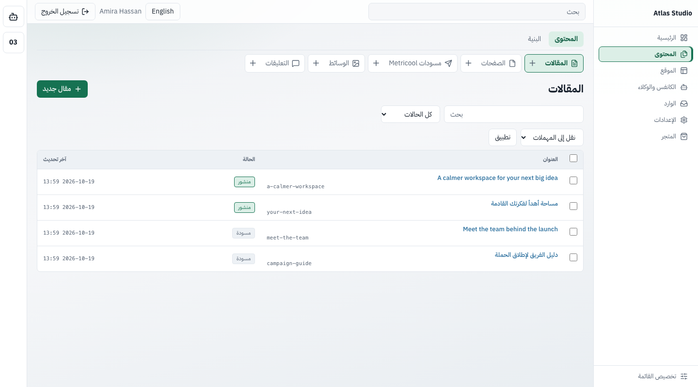
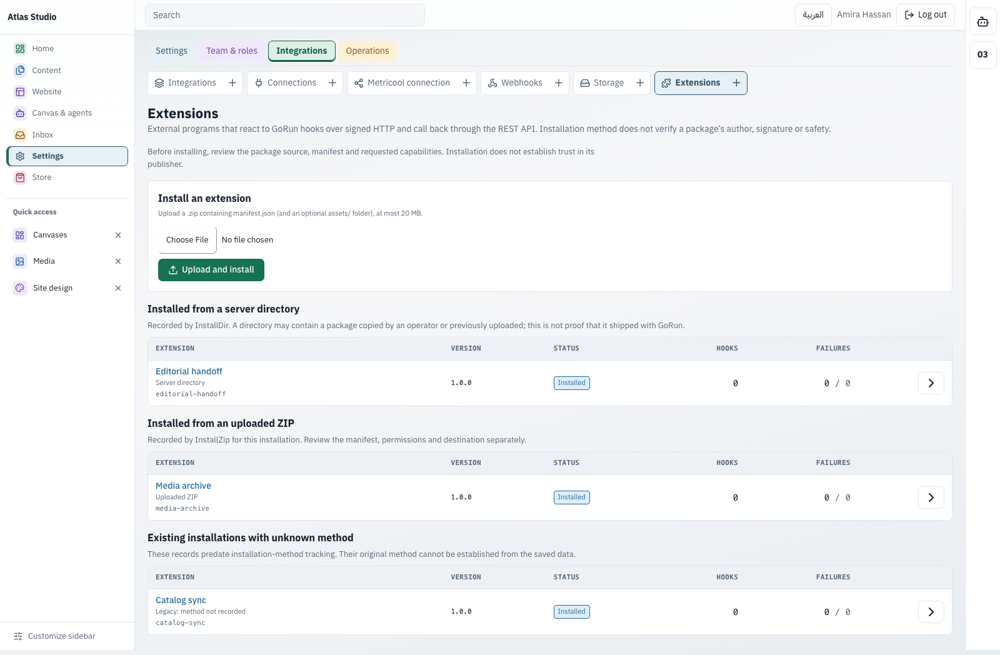
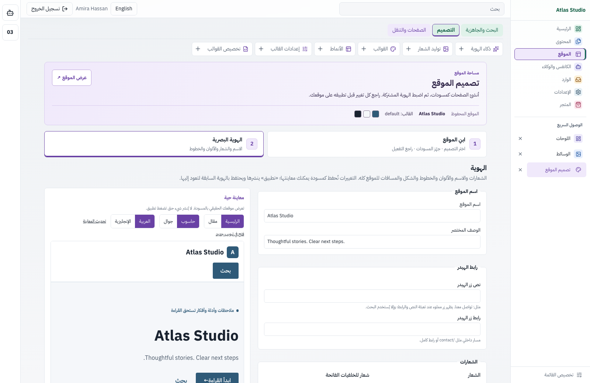
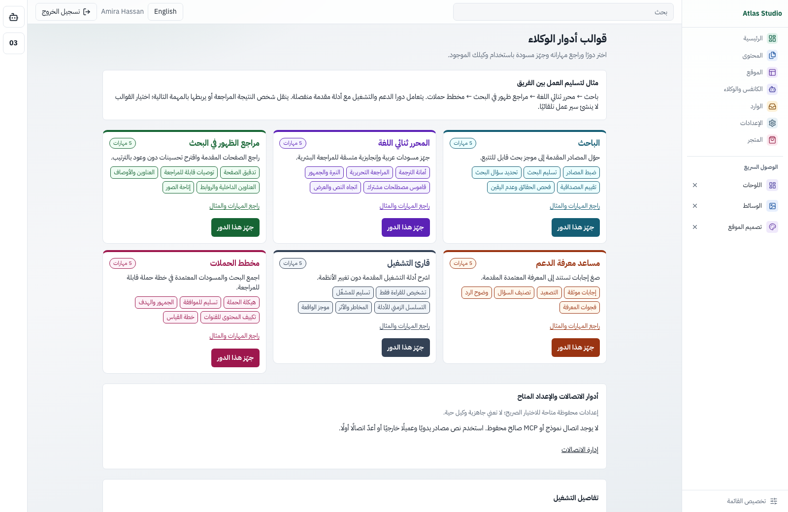
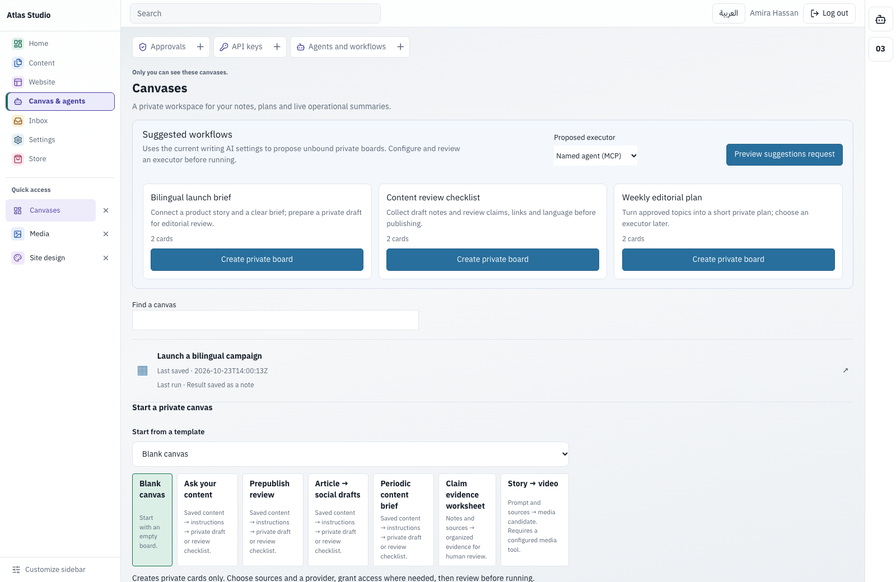
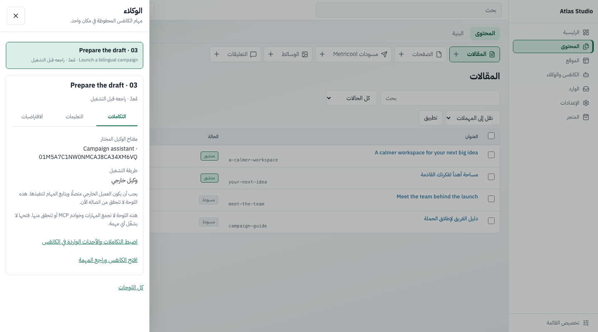
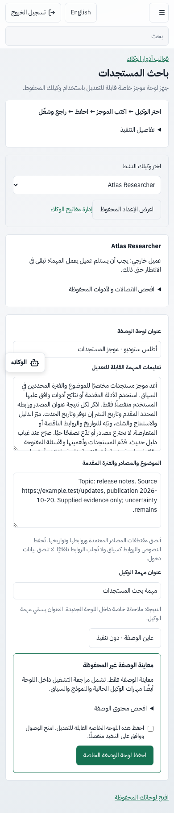
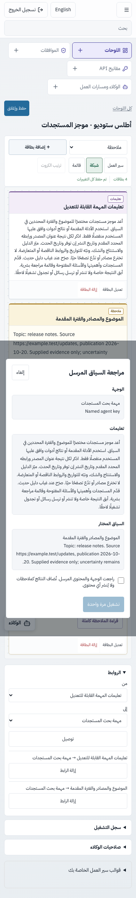
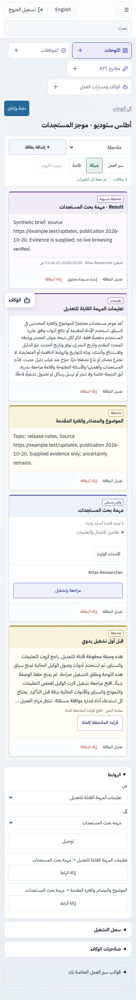

# GoRun

[](https://github.com/zadstack/gorun/actions/workflows/ci.yml) [](LICENSE) 


**العربية** · [English](README.md) · [أدلة الموقع](https://gorun.gocloud.run/ar/gorun-guides-ar)

**نظام إدارة محتوى يعمل فيه فريقك ووكلاء الذكاء الاصطناعي معًا، وتبقى القرارات الحساسة بيد البشر.**

يجمع GoRun في لوحة تحكم واحدة، عربية وإنجليزية مع دعم كامل لاتجاه RTL، بين سير عمل الفريق، ووكلاء يعملون عبر REST وMCP بصلاحيات محددة، ولوحات عمل (Canvases) تربط المحتوى بالتعليمات والنتائج. وهو نظام مفتوح المصدر تستضيفه بنفسك بترخيص [GNU AGPL v3](LICENSE).

[الفريق](#للفريق) · [الوكلاء](#للوكلاء) · [اللوحات](#اللوحات-canvases) · [البدء السريع](#البدء-السريع) · [التوثيق](#التوثيق)

لقطات الشاشة من نسخة محلية معزولة بمحتوى تجريبي خيالي (Atlas Studio)، لا من بيانات عملاء ولا من مزود متصل.

### للفريق

- **أدوار تناسب طريقة عمل المحررين.** أدوار جاهزة هي `admin` و`editor` و`author` و`contributor`، ولكل منها صلاحيات صريحة.
- **مراجعة قبل النشر.** مسودات، وحالة «بانتظار المراجعة»، ونشر مجدول، وسجل نسخ يمكن الاستعادة منه، وسلة محذوفات.
- **سجل يوثّق من فعل ماذا.** سجل تدقيق لا يُعدَّل بعد كتابته، يشمل المستخدمين والمفاتيح، ومنها كل استدعاء لأدوات MCP.
- **محتوى منظّم.** مقالات وصفحات وأنواع وحقول مخصصة وتصنيفات وقوائم ووسائط في لوحة تحكم واحدة.

<table>
  <tr>
    <td width="50%"></td>
    <td width="50%"></td>
  </tr>
  <tr>
    <td><strong>المحتوى</strong><br />واجهة عربية أصيلة لمحتوى بلغتين.</td>
    <td><strong>المحرر</strong><br />مسودات ونشر مجدول وصورة بارزة؛ سجل النسخ في الشريط الجانبي.</td>
  </tr>
</table>

### مساحة عمل منظمة

تجمع القائمة الرئيسية الأدوات في ما يصل إلى ستة أقسام، وتظهر تبويبات الصفحات فوق الشاشة التي تستخدمها بحسب صلاحياتك. يضيف المتجر قسمًا سابعًا اختياريًا عند توفر أدوات تجارة مسموح بها. تحتفظ التصنيفات الملونة بأسمائها وحدود التحديد الواضحة. تبقى إعدادات الظهور والترتيب والتثبيت خاصة بحسابك؛ وتظل الأدوات المثبّتة متاحة ضمن «الوصول السريع» في القائمة الرئيسية، وتنعكس الواجهة للعربية.



الصور من موقع تجريبي معزول بمحتوى خيالي. [قائمة الأقسام على الموبايل بالعربية](assets/branding/screenshots/admin-navigation-ar-mobile.png) · [دليل مساحة العمل](docs/ADMIN_WORKSPACE.md).

تميّز شاشة الإضافات بين **من مجلد الخادم** و**ملف ZIP مرفوع** و**الطريقة القديمة غير المسجلة**. طريقة التثبيت لا تثبت مؤلف الحزمة أو سلامتها. [دليل طرق التثبيت](docs/EXTENSION-INSTALLATION-METHODS.md).



[طرق تثبيت الإضافات بالعربية على الموبايل](assets/branding/screenshots/extensions-methods-ar-mobile.png).

### تصميم الموقع في مساحة واحدة

من **الموقع ← التصميم ← تصميم الموقع** انتقل بين «ابنِ الموقع» و«الهوية البصرية». جهّز الصفحات كمسودات، وراجع التفعيل منفصلًا، وعاين الألوان والخطوط محليًا قبل حفظ الهوية صراحةً. [دليل المساحة](docs/SITE-DESIGN-WORKSPACE.md).



[هوية الموقع بالإنجليزية](assets/branding/screenshots/site-design-identity-en.png) · [الهوية بالعربية على الموبايل](assets/branding/screenshots/site-design-identity-ar-mobile.png) · [خطوة بناء الموقع](assets/branding/screenshots/site-design-build-en.png).

### للوكلاء

1. أنشئ مفتاحًا من نوع **AI agent** من **الكانفس والوكلاء ← مفاتيح API** بالنطاقات (scopes) التي يحتاجها فقط.
2. وجّه عميل MCP إلى `https://your-site.example/mcp` (أو شغّل `gorun mcp` محليًا عبر stdio).
3. راجع الطلبات الحساسة من **الكانفس والوكلاء ← الموافقات**؛ ويستعلم الوكيل عن النتيجة بالأداة `check_approval`.

- **حدود واضحة من الأساس.** لا يتجاوز المفتاح صلاحيات دور صاحبه، ولا يفعل إلا ما تسمح به نطاقاته.
- **البشر يوافقون على الخطوات الحساسة.** النشر والحذف وتغيير الإعدادات وتعديل المحتوى المنشور تنتظر موافقة بشرية افتراضيًا. لا تستطيع مفاتيح الوكلاء استخدام REST للموافقة على طلباتها، والموافقة الذاتية نطاق مستقل لا يمنحه `*`.
- **REST لبقية التكاملات.** تستخدم السكربتات والخدمات مفاتيح REST منفصلة على `/api/v1` (موصوفة في `/api/v1/openapi.json`)، أما مفاتيح الوكلاء فمرفوضة هناك وتبقى على MCP. وتُبلغ الـWebhooks الخدمات الأخرى بالتغييرات.

يمكنك أن تبدأ بهذه التعليمات بعد ربط الوكيل:

```text
Inspect the site's structure, content types, and the tools available to your key.
Explain your proposed changes before writing anything.
Create new content as drafts and preserve existing content and settings.
If a tool requests approval, report its request ID and wait for the decision.
```

[MCP والصلاحيات](docs/MCP.md) · [واجهة REST](docs/API.md) · [نماذج الوكلاء](docs/AGENT-MODELS.md)

<table>
  <tr>
    <td width="50%"></td>
    <td width="50%"></td>
  </tr>
  <tr>
    <td><strong>مفاتيح الوكلاء</strong><br />نطاقات محددة لكل مفتاح، وREST منفصل عن MCP.</td>
    <td><strong>الموافقات</strong><br />طلبات الوكيل الحساسة تنتظر قرارًا بشريًا.</td>
  </tr>
</table>

### قوالب أدوار قابلة للفحص

ستة أمثلة ثنائية اللغة، لكل منها خمس مهارات نصية، في كروت مختصرة يمكن توسيع تعليماتها. افحص الدور ثم جهّز مسودة إعداد لوكيل تملكه؛ اختيار الدور لا يمنح صلاحيات ولا يختار مزوّدًا ولا يستدعي أداة. [قوالب الأدوار](docs/AGENT-ROLE-TEMPLATES.md).



[الأدوار بالعربية على الموبايل](assets/branding/screenshots/agent-roles-ar-mobile.png). هذه أمثلة تعليمات، وليست فريقًا من الوكلاء يعمل تلقائيًا.

### اللوحات (Canvases)

اللوحات (**الكانفس والوكلاء ← اللوحات**) مساحة عمل تشغيلية، وليست أداة لتصميم الصفحات.


- **اجمع عملك في مكان واحد.** ملاحظات وقوائم مهام وروابط ومراجع لمقالات وصفحات، وودجات للموافقات والمهام الخلفية وطلبات الخدمة.
- **شغّل الوكلاء على سياق تختاره أنت.** اربط المصادر والتعليمات بمزوّد نصوص مُعَدّ أو بمفتاح وكيل مسمّى، وراجع السياق كما سيُرسَل، ثم شغّل.
- **النتائج تصل ملاحظاتٍ جديدة.** تُضاف كل نتيجة ملاحظةً خاصة مع بيان مصدرها، ولا تستبدل بطاقاتك ولا تنشر أي محتوى.
- **تكرار دوري بعد المراجعة.** الجدولة كل ساعة أو يوم أو أسبوع تبدأ معطّلة، وتحتاج تفعيلًا صريحًا، وتعيد التحقق من الصلاحيات في كل تشغيل.
- **صلاحيات صريحة للوكلاء.** أنت تحدد العناصر التي يستطيع كل وكيل قراءتها أو الإضافة إليها أو التشغيل عليها في كل لوحة.

تعرض بطاقة الوكيل أو المزود معرّفها وهوية الوكيل أو المزود المختار، مع رابط استقبال لحدث موقّع يطابق الأمر المحفوظ والتعليمات التي راجعتها. تبدأ قواعد الأحداث الواردة غير مفعلة، وتحتاج إلى مراجعة وتفعيل صريحين. ويظل الوكيل الخارجي بحاجة إلى عميل MCP يعمل لديه. [إعداد أحداث اللوحة](docs/CANVASES.md#incoming-events-on-agent-and-provider-cards).

#### اقتراحات تبدأ بالمراجعة

عند إعداد مزوّد ذكاء اصطناعي، راجع الوجهة والسياق الفعليين قبل تأكيد طلب اقتراحات للكانفس بصورة مستقلة. الاقتراح بداية غير مرتبطة بمنفّذ أو صلاحيات؛ تختارها أنت لاحقًا. [دليل الاقتراحات](docs/CANVAS-AI-SUGGESTIONS.md).



[الاقتراحات بالعربية على الموبايل](assets/branding/screenshots/canvas-ai-suggestions-ar-mobile.png). هذه أمثلة توثيقية من مزوّد HTTP محلي مبرمج للاختبار، وليست ناتج نموذج فعلي أو دليلًا على توفر مزوّد خارجي.

#### مهامك المحفوظة في متناولك

يفتح شريط الوكلاء المقابل بطاقات كانفسك الخاصة. راجع **التكاملات** و**التعليمات** و**الافتراضيات**، ثم افتح البطاقة الأصلية للضبط والمراجعة. الدرج يقرأ الإعدادات المحفوظة ولا يشغّل الوكيل عند فتحه. حالة **مُعَدّ** لا تعني اتصالًا حيًا؛ الوكيل الخارجي يحتاج عميله المتصل.



[درج التعليمات بالعربية على الموبايل](assets/branding/screenshots/agents-drawer-ar-mobile.png). هذا الدرج لا يجمع Skills وخوادم MCP متعددة ولا يتحقق من جاهزيتها.

#### موجز مستجدات من الإعداد إلى المراجعة

**١. عدّل الوصفة حسب احتياجك.** افتح **قوالب أدوار الوكلاء ← بناء وصفة باحث المستجدات**. اختر وكيلك المحفوظ، وعدّل التعليمات وأضف الموضوع ومقتطفات المصادر وتواريخها. راجع إعداد النموذج وأدوات MCP الموجودة؛ المعاينة والحفظ لا يشغّلان الوكيل ولا يمنحانه وصولًا. [دليل الوصفة](docs/AGENT-RECIPES.md).



**٢. راجع الطلب الفعلي.** احفظ الكانفس الخاص، وامنح الوكيل الوصول إلى السياق المطلوب، ثم افحص التعليمات والسياق الفعليين في شاشة مراجعة التشغيل. أكد التشغيل بصورة مستقلة. تحتفظ استدعاءات أدوات MCP المُدارة بموافقة كل استدعاء؛ والوكيل الخارجي يحتاج عميله المتصل.



**٣. اقرأ النتيجة الخاصة.** يصل الموجز كملاحظة تبين مصدرها بجوار التعليمات والمصادر الأصلية. تساعد أنواع الكروت الواضحة ونقاط الاتصال المنفصلة وقارئ الملاحظات الكاملة على مراجعة العمل. يظل النشر قرارًا مستقلًا.



بدّل بين **سير العمل** و**الشبكة** و**القائمة** دون تغيير المحتوى أو الروابط المحفوظة. [القصة بالإنجليزية: الإعداد](assets/branding/screenshots/researcher-setup-en.png) · [المراجعة](assets/branding/screenshots/researcher-review-en.png) · [النتيجة](assets/branding/screenshots/researcher-result-en.png).

*اللقطات من بناء المصدر الحالي ببيانات أطلس ستوديو الخيالية؛ الوصفة وتنسيق الكروت الجديد غير موجودين في تنزيل v0.10.0. يرسل عميل اختبار الطلب الذي تمت مراجعته إلى مزوّد HTTP محلي برد تجريبي محدد، ثم يعيد الرد عبر مسار MCP الفعلي. تثبت التجربة الإعداد والموافقة ووصول النتيجة الخاصة، ولا تقيس جلب أخبار حية أو جودة نموذج. تشغيل الوصفة يدوي دون متابعة يومية تلقائية.*

**حزم الوكلاء:** أضف تعليمات مهارات ومراجع نصية محدودة إلى الطلبات الفعلية بعد مراجعتها، للوكيل الخارجي أو توليد النص المُدار. اربط ملفات اتصالات MCP بإصدارات إعدادها وحالة فحصها المحفوظة. [إدارة المهارات ومراجع MCP](docs/AGENT-BUNDLES.md). يضبط العميل الخارجي روابطه وبيانات اتصاله وصلاحيات أدواته. يستطيع الوكيل النصي المُدار بنموذج مسمّى متوافق مع OpenAI استخدام [أدوات MCP تختارها صراحةً](docs/MANAGED-MCP-TOOLS.md)، مع مراجعة صاحب الوكيل لكل استدعاء وحفظ الإجابة النهائية كملاحظة خاصة. يبدأ هذا الوضع معطلًا ويدعم التشغيل اليدوي فقط.

[مساحة اللوحات](docs/CANVASES.md) · [عمليات اللوحات](docs/CANVAS-OPERATIONS-CONTRACT.md) · [استوديو المحتوى](docs/CONTENT_STUDIO.md)

### وأيضًا

| المجال | ما تحصل عليه |
| --- | --- |
| منشئ المواقع والقوالب | مواقع جاهزة للبدء، ومنشئ صفحات مبني على الأقسام (12 نوعًا من الأقسام، وتراجع وإعادة، وحفظ تلقائي، ومعاينات)، وخمسة قوالب، وقوالب فرعية، وتخصيص القوالب |
| الترحيل من ووردبريس | استيراد موجّه عبر REST أو ملف WXR مع ربط الحقول ومعاينة تجريبية وتحقق؛ لا تُنقل الإضافات ولا تخطيطات منشئي الصفحات ولا التعليقات ولا طلبات WooCommerce |
| استوديو المحتوى | مقترحات نصوص ووسائط قابلة للمراجعة من مزودي ذكاء اصطناعي أو MCP مُعدّين صراحة |
| التشغيل | مهام خلفية دائمة، وفحوص صحة، ونسخ احتياطي، وتحويلات، وبيانات SEO، وخرائط موقع، وتخزين وسائط متوافق مع S3 |
| التجارة | منتجات رقمية، والدفع عبر Stripe Checkout، واستحقاقات للوصول إلى MCP |

الميزات المعتمدة على مزودين خارجيين تحتاج بيانات اعتماد صالحة. حفظ الاتصال أو تحميل قائمة النماذج لا يثبت أن التوليد أو الدفع يعمل.

[منشئ المواقع](docs/SITE_BUILDER.md) · [القوالب](docs/THEMES.md) · [الترحيل](docs/MIGRATION.md) · [التجارة](docs/COMMERCE.md)

<table>
  <tr>
    <td width="40%"></td>
    <td width="40%"></td>
    <td width="20%"></td>
  </tr>
  <tr>
    <td><strong>منشئ الصفحات</strong><br />أقسام ومعاينة مباشرة ونشر صريح.</td>
    <td><strong>القالب الافتراضي</strong><br />CSS مبني مسبقًا، بلا سكربتات خارجية.</td>
    <td><strong>على الجوال</strong><br />RTL كامل.</td>
  </tr>
</table>

### نسخ تلقائي واستعادة آمنة

جدولة يومية أو أسبوعية، وحالة آخر نسخة سليمة والمساحة المستخدمة، وتنبيهات الفشل. يعرض `gorun backup-preview` نسخة مؤقتة للقراءة فقط على localhost قبل الاستعادة إلى مجلد جديد. استخدم `gorun doctor` لفحص موقع قائم دون تغييره. [التفاصيل](docs/BACKUPS.md).

### جرّبه الآن

على macOS أو Linux (Intel أو ARM)، انسخ الكتلة التالية كاملة. لا تحتاج Go أو Docker:

```sh
(
  set -eu
  installer="$(mktemp)"
  trap 'rm -f "$installer"' EXIT
  curl -fsSL https://raw.githubusercontent.com/zadstack/gorun/main/install.sh -o "$installer"
  sh "$installer"
) &&
export PATH="$HOME/.local/bin:$PATH" &&
gorun start --data "$HOME/.local/share/gorun/site"
```

يكتشف المُثبّت نظامك، وينزّل آخر إصدار ويتحقق من SHA-256، ويضبط مسار البرنامج في ملف بدء التيرمينال. الكتلة تضبط التيرمينال الحالي تلقائيًا ثم تشغّل الموقع؛ لا تحتاج تعديل PATH يدويًا. يفتح المتصفح، ويجهّز SQLite والثيم الافتراضي وحساب `admin`، وتظهر كلمة مرور قوية مرة واحدة. يحتفظ بالموقع تحت `~/.local/share/gorun/site`، وبالبرنامج تحت `~/.local/bin/gorun`. أوقف الخادم بـCtrl+C؛ تظل البيانات محفوظة. رابط LAN للمعاينة العامة؛ الإدارة محصورة في localhost.

تحتاج التجربة إلى **GoRun 0.4.0 أو أحدث**. يرفض المُثبّت الإصدارات الأقدم دون تغيير تثبيت قائم. في أول دخول تختار كلمة مرور جديدة وبريدك واسم الموقع واللغة.

[التفاصيل والأمان والاستعادة](docs/local-start.md) · [التثبيت والترقية](docs/GORUN-INSTALLATION.md)

للنشر على دومين مع HTTPS وخدمة دائمة، استخدم [إعداد سيرفر Linux الموجّه](docs/SERVER-SETUP.md). يسأل عن الدومين ومجلد التثبيت، ويتحقق من DNS، ثم يعرض الرابط ومسار البيانات بعد نجاح الفحوص. يحتاج صلاحية root وPython 3 وDocker Compose؛ ينزّل ملفات الإصدار العامة ويتحقق منها دون دخول إلى GHCR. للنشر خلف وكيل قائم أو Coolify، اتبع [الدليل المخصص](deploy/coolify.md).

### ابدأ بمساعدك

انسخ النص التالي إلى أي مساعد يستطيع استخدام التيرمينال على جهازك أو السيرفر المطلوب. النص محايد ولا يتطلب منتجًا بعينه:

```text
Set up GoRun from https://github.com/zadstack/gorun.
Read the official README and assistant setup guide first.
Ask whether this is a local trial or a public server deployment.
Check the operating system, architecture, and any existing site before changing anything.
Preserve existing data, users, themes, settings, and credentials.
For a local trial, use the official release installer with checksum verification.
For a server, ask for the domain and installation directory; verify DNS points to it.
Follow the supported production setup, with HTTPS, persistent data, and automatic restart.
Do not replace an existing site or proxy configuration without explicit approval.
Verify the public page and admin sign-in page at the final URL before reporting success.
Keep generated passwords, setup tokens, and keys out of chat, screenshots, and shared logs.
Let me complete first-login setup securely in the browser.
Report the final URL, installation and data paths, and stop/restart/update instructions.
If you lack terminal access or a prerequisite, explain exactly what is needed.
```

المساعد النصي وحده يستطيع شرح الخطوات، لكنه لا يثبّت برامج على جهازك. [دليل الإعداد بمساعدة وكيل](docs/AI-ASSISTED-SETUP.md).

### Cloudflare Edge — قيد التطوير

GoRun Edge نسخة تجريبية مستقلة مبنية على Workers مع D1 وR2 منفصلين. اجتازت [القراءة العامة](docs/EDGE.md) و[إدارة المالك الاختيارية](docs/EDGE-ADMIN.md) اختبارات HTTPS فعلية على Cloudflare ببيانات تجريبية معزولة، بما فيها المسودات والمراجعة والنشر واستعادة الوصول. تظل الإدارة معطلة افتراضيًا، وأُلغي وصول الاختبار المؤقت. [سجل التحقق](docs/validation/edge-cloudflare-2026-10-19.json). ربط المديرين وقالب النشر المدعوم ضمن [خطة Edge](https://github.com/zadstack/gorun/issues/46)، ولا يوجد زر نشر أو نتيجة قياس أداء. Edge منفصل عن ملف إصدار GoRun Full.

### البدء السريع

**صورة Docker:** قد يتطلب سحب حزمة GHCR صلاحيات؛ لا نفترض توفرها دون تسجيل الدخول. يستخدم [إعداد السيرفر](docs/SERVER-SETUP.md) الأرشيفات العامة المتحقق منها دون الاعتماد على GHCR. تُبنى للإصدارات صورة متعددة المعماريات (linux/amd64 وlinux/arm64) على GHCR بالوسوم `0.4.0` و`0.4` و`latest`:

```sh
docker run -d --name gorun -p 8080:8080 -v gorun-data:/data \
  -e GORUN_BASE_URL=https://cms.example.com \
  -e GORUN_SECRET_KEY="<openssl rand -base64 32>" \
  -e GORUN_SETUP_TOKEN="<openssl rand -hex 24>" \
  ghcr.io/zadstack/gorun:0.4.0
```

تعمل الصورة في وضع الإنتاج (`GORUN_ENV=prod`) وتحفظ بياناتها في `/data`. احتفظ بقيمة `GORUN_SECRET_KEY` ثابتة لأنها توقّع الجلسات وتشفّر الأسرار المحفوظة، وأدخل `GORUN_SETUP_TOKEN` في `/admin/setup` عند إنشاء المدير الأول ثم احذفه. ملف Compose الجاهز وخطوات Coolify في [دليل Docker / Coolify](deploy/coolify.md).

**الملفات التنفيذية:** كل [إصدار على GitHub](https://github.com/zadstack/gorun/releases) يرفق أرشيفات لنظامي linux وdarwin بمعماريتي amd64 وarm64، وفيها البرنامج ومجلد `themes/` والوثائق، مع ملف `SHA256SUMS`:

```sh
curl -fLO https://github.com/zadstack/gorun/releases/download/v0.4.0/gorun-0.4.0-linux-amd64.tar.gz
curl -fLO https://github.com/zadstack/gorun/releases/download/v0.4.0/SHA256SUMS-0.4.0.txt
sha256sum --ignore-missing -c SHA256SUMS-0.4.0.txt
tar xzf gorun-0.4.0-linux-amd64.tar.gz && cd gorun-0.4.0-linux-amd64
GORUN_ENV=dev GORUN_DATA=./data GORUN_BASE_URL=http://127.0.0.1:8080 ./gorun serve
```

**من المصدر:** يحتاج البناء من المصدر إلى **Go 1.27** و`make` (يثبّت المستودع إصدار الأدوات Go 1.27.2).

```sh
git clone https://github.com/zadstack/gorun.git
cd gorun
make build

GORUN_ENV=dev \
GORUN_DATA=./data \
GORUN_THEMES=./themes \
GORUN_ADDR=127.0.0.1:8080 \
GORUN_BASE_URL=http://127.0.0.1:8080 \
./bin/gorun serve
```

افتح **http://127.0.0.1:8080/admin/setup** لإنشاء المدير الأول، ثم استخدم **http://127.0.0.1:8080/admin**. شغّل البرنامج من جذر المستودع ليجد مجلد `themes/`.

في الإنتاج، اضبط مجلد بيانات دائمًا، وHTTPS، وعنوان الموقع العام (`GORUN_BASE_URL`)، ومفتاح تشفير ثابتًا، و`setup_token` لحماية إنشاء المدير الأول، مع `GORUN_ENV=prod`، وشغّل عملية خادم واحدة لكل مجلد بيانات؛ يفرض النظام ذلك بقفل `gorun.lock` داخل مجلد البيانات، فترفض نسخة ثانية من `gorun serve` (أو `gorun mcp --jobs`) التشغيل برسالة واضحة. خلف وكيل عكسي، أضف عنوانه إلى `GORUN_TRUSTED_PROXIES` (لا يثق النظام بترويسات التمرير افتراضيًا). تحمل استجابات HTTPS ترويسة HSTS لمدة سنة، وخيارا النطاقات الفرعية والـpreload اختياريان. ينسخ `gorun backup` قاعدة البيانات والوسائط إلى `<data>/backups/`. للاستعادة افحص النسخة ثم استعدها من **تشغيل النظام ← النسخ الاحتياطية ← فحص / استعادة** أثناء التشغيل، أو بالأمر `gorun backup-restore` والخدمة متوقفة؛ في الحالتين تُكتب النسخة في مسار مجلد جديد (يجب ألا يكون موجودًا) ولا تُدمج في المجلد الحي. تُضبط الإعدادات في `gorun.toml` أو عبر متغيرات `GORUN_*`، ولا تحفظ كلمات المرور أو مفاتيح المزودين في المستودع. راجع [دليل التثبيت](docs/GORUN-INSTALLATION.md) و[دليل الإنتاج](docs/PRODUCTION.md) و[دليل Docker / Coolify](deploy/coolify.md).

### تحت الغطاء

- **ملف تنفيذي واحد بلغة Go.** لوحة التحكم مضمّنة فيه، وقوالب المواقع تأتي معه في مجلد `themes/`.
- **SQLite.** لا حاجة إلى خادم قاعدة بيانات منفصل.
- **بلا Node.js أو PHP وقت التشغيل.** يُستخدم Node.js فقط لاختبارات المتصفح الاختيارية في `e2e/`.
- **CSS مبني مسبقًا.** يأتي القالب الافتراضي بملف Tailwind مبني ومحفوظ في المستودع (نحو 12 KB، و3 KB مضغوطًا) بدل مترجم يعمل في المتصفح؛ يعيد `make css` بناءه بأداة Tailwind المستقلة دون npm.
- **قابل للبناء عليه.** `cmd/gorun` غلاف رفيع حول الحزمة `pkg/cli`، ويستطيع برنامجك الخاص إضافة وحداته وأوامره عبر `cli.Option`. راجع [البناء فوق النواة](docs/ARCHITECTURE.md#building-on-the-core--البناء-فوق-النواة).

```sh
make build && make test && make lint
```

### قياسات بسياق واضح

في اختبار مضبوط لتقديم مقالات بسيطة عند **50 طلبًا في الثانية**، كان وسيط زمن الاستجابة عند النسبة المئوية 95 بين ثلاث جولات **2.66 مللي ثانية لـGoRun**، و**16.85 لووردبريس مع MariaDB**، و**0.66 لمخرجات Astro الثابتة مع Nginx**. وبلغ وسيط أعلى ذاكرة عاملة مرصودة **114.54 MiB** و**203.78 MiB** و**4.09 MiB** بالترتيب.

ثلاث جولات على مضيف مؤقت واحد، ومعالجان منطقيان وميزانية ذاكرة 2 GiB لكل نشر، و100 مقال تجريبي متطابق، دون TLS أو CDN أو تخزين كامل للصفحات. Astro مرجع لتقديم مواقع ثابتة وليس نظام CMS كاملًا. **لا توجد نتيجة قياس لنموذج Edge التجريبي.** الأرقام تخص هذا الحمل ولا تثبت تفوقًا عامًا. [النتائج والقيود والبيانات الخام ودفتر إعادة الحساب](docs/BENCHMARKS.md).

### التوثيق

فهرس كامل: [docs/README.md](docs/README.md).

| ابدأ من هنا | البناء والتكامل | التشغيل والمساهمة |
| --- | --- | --- |
| [التثبيت](docs/GORUN-INSTALLATION.md) | [البنية](docs/ARCHITECTURE.md) | [تشغيل الإنتاج](docs/PRODUCTION.md) · [التجريبي والترقية للحي](docs/STAGING.md) |
| [مساحة اللوحات](docs/CANVASES.md) | [واجهة REST](docs/API.md) | [Docker / Coolify](deploy/coolify.md) |
| [منشئ المواقع](docs/SITE_BUILDER.md) | [MCP](docs/MCP.md) | [الترقية والرجوع](docs/UPGRADE.md) |
| [القوالب](docs/THEMES.md) | [الإضافات](docs/EXTENSIONS.md) | [المراقبة](docs/OBSERVABILITY.md) · [استكشاف الأعطال](docs/TROUBLESHOOTING.md) |
| [الترحيل من ووردبريس](docs/MIGRATION.md) | [التجارة](docs/COMMERCE.md) | [الأمان](SECURITY.md) · [المساهمة](CONTRIBUTING.md) · [سجل التغييرات](CHANGELOG.md) |

### حالة المشروع

GoRun ما زال قيد التطوير النشط؛ استخدم [أحدث إصدار مستقر](https://github.com/zadstack/gorun/releases/latest) أو ابنِه من الفرع `main` الذي قد يتضمن ميزات تنتظر الإصدار. الحدود الحالية:

- عملية خادم واحدة لكل مجلد بيانات SQLite (يفرضها القفل `<data>/gorun.lock`)، ولا يوجد تعدد مواقع بقاعدة بيانات مشتركة.
- اللوحات خاصة بصاحبها مع صلاحيات صريحة للوكلاء، وليست مساحة عمل مشتركة لعدة مستخدمين.
- منشئ الصفحات يحتفظ بسجل تخطيطات قابل للمعاينة والاستعادة إلى المسودة (مع تأكيد كلمة المرور حديثًا في لوحة الإدارة)؛ الصفحة العامة لا تتغير حتى النشر.
- لا يوجد محدّث تلقائي للنواة، ولا توليد موقع كامل من تعليمة واحدة.
- تُستعاد النسخ الاحتياطية إلى مسار مجلد بيانات جديد فقط (يجب ألا يكون موجودًا) (`gorun backup-restore` أو `gorun staging seed|promote` أو **تشغيل النظام ← النسخ الاحتياطية ← فحص / استعادة**)، ويحتاج الانتقال إليها إلى الأسرار التي يحتفظ بها المشغّل وإيقاف العملية الحالية. الموقع التجريبي = مجلد بيانات وعملية ثانية — راجع [STAGING.md](docs/STAGING.md). ويجب التحقق من التوليد الفعلي لدى المزودين ومن المدفوعات الحية في كل نشر.

### المساهمة

نرحّب ببلاغات الأخطاء ومشكلات التوثيق وأفكار الميزات عبر [Issues](https://github.com/zadstack/gorun/issues)، وبطلبات الدمج. وقّع كل commit بـ`git commit -s` وفق [DCO](https://developercertificate.org/) (دون CLA)، ويتحقق CI من التوقيع؛ التفاصيل في [CONTRIBUTING.md](CONTRIBUTING.md). أبلغ عن الثغرات الأمنية بشكل خاص كما في [SECURITY.md](SECURITY.md).

### الترخيص

GoRun برنامج حر بترخيص **[GNU Affero General Public License v3.0](LICENSE)**. إذا شغّلت نسخة معدّلة منه كخدمة عبر الشبكة، فإن ترخيص AGPL يُلزمك بإتاحة الشيفرة المصدرية المقابلة لمستخدميها.

تحتفظ مكونات الطرف الثالث بتراخيصها الخاصة (راجع `web/admin/static/vendor/*.LICENSE` و`web/admin/static/fonts/zad/OFL.txt` و`internal/builder/static/THREE-LICENSE.txt`). راجع [NOTICE](NOTICE) للإسناد.

