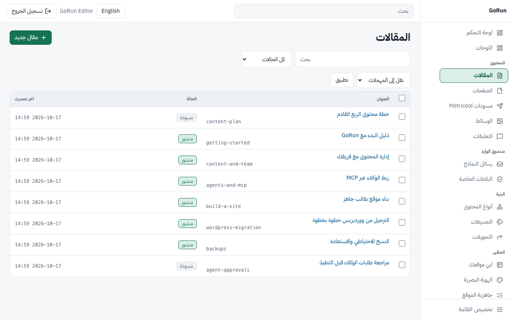
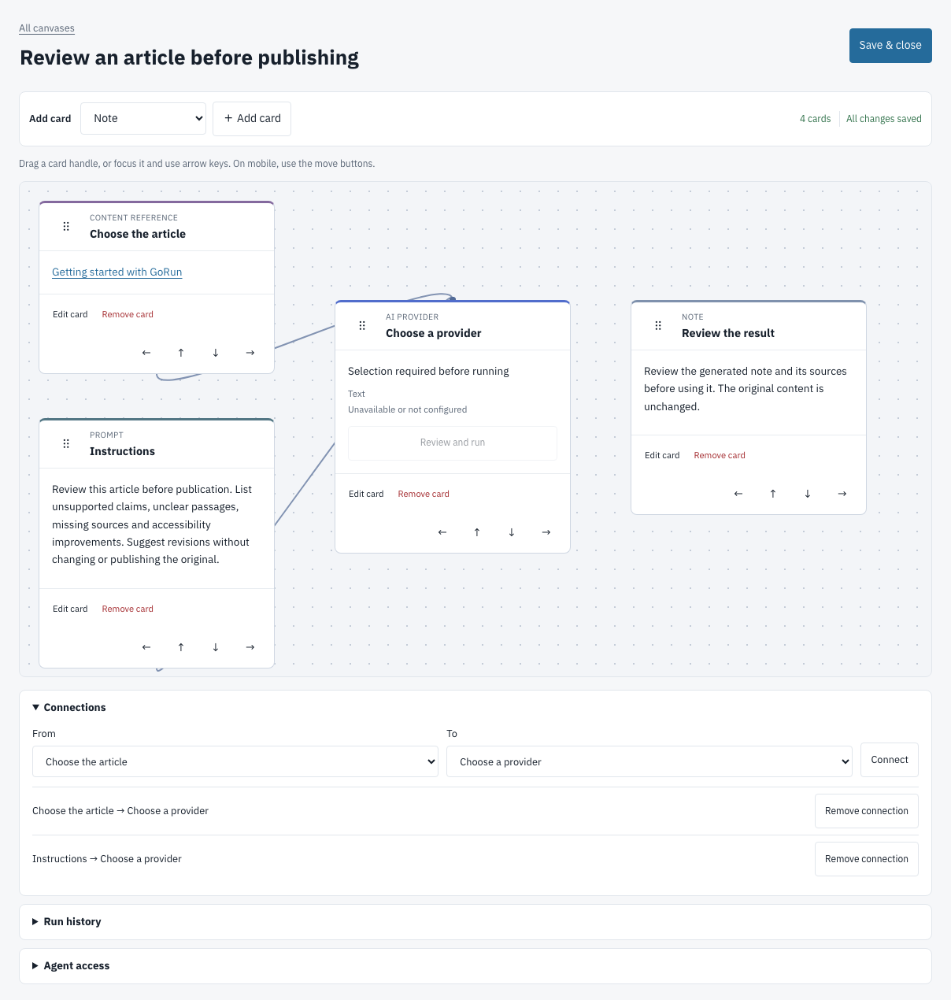

# GoRun

[](https://github.com/zadstack/gorun/actions/workflows/ci.yml) [](LICENSE) 


**العربية** · [English](#english)

**نظام إدارة محتوى يعمل فيه فريقك ووكلاء الذكاء الاصطناعي معًا، وتبقى القرارات الحساسة بيد البشر.**

يجمع GoRun في لوحة تحكم واحدة، عربية وإنجليزية مع دعم كامل لاتجاه RTL، بين سير عمل الفريق، ووكلاء يعملون عبر REST وMCP بصلاحيات محددة، ولوحات عمل (Canvases) تربط المحتوى بالتعليمات والنتائج. وهو نظام مفتوح المصدر تستضيفه بنفسك بترخيص [GNU AGPL v3](LICENSE).

### الفريق

- أدوار جاهزة: مدير ومحرر ومؤلف ومساهم، ولكل منها صلاحيات واضحة.
- مسودات ومراجعة قبل النشر، ونشر مجدول، وسجل نسخ يمكن الاستعادة منه، وسلة محذوفات.
- سجل تدقيق يوثّق ما فعله كل مستخدم وكل مفتاح.

### الوكلاء

- خادم MCP على `/mcp` (وعبر stdio بالأمر `gorun mcp`)، وواجهة REST موثقة بـOpenAPI للسكربتات والخدمات الأخرى بمفاتيح منفصلة.
- مفاتيح مخصّصة للوكلاء، لكل مفتاح نطاقات (scopes) محددة، ولا يتجاوز أبدًا صلاحيات صاحبه.
- النشر والحذف وتغيير الإعدادات وتعديل المحتوى المنشور تنتظر موافقة بشرية افتراضيًا، ولا يستطيع الوكيل الموافقة على طلباته.

### اللوحات (Canvases)

- مساحة عمل تشغيلية لكل مستخدم: ملاحظات وقوائم مهام وروابط ومراجع لمقالات وصفحات وودجات تشغيلية.
- اربط المحتوى والتعليمات بمزوّد نصوص أو بوكيل، وراجع السياق قبل التشغيل، فتُضاف النتيجة ملاحظةً خاصة جديدة ولا تستبدل عملك.
- جدولة دورية بعد المراجعة، مع وصول محدد تمنحه أنت لكل وكيل على كل لوحة.

اللوحات منفصلة عن **منشئ الصفحات** المبني على الأقسام، الذي تصمم به صفحات موقعك العامة.

**وأيضًا:** أنواع محتوى وحقول مخصصة، ومنشئ مواقع بخمسة قوالب، وترحيل من ووردبريس، ونسخ احتياطي وتحويلات وSEO، ومتجر للمنتجات الرقمية عبر Stripe.

### البدء السريع

يحتاج البناء إلى **Go 1.27** و`make`. الأوامر في [القسم الإنجليزي](#quick-start)؛ بعد التشغيل افتح **http://127.0.0.1:8080/admin/setup** لإنشاء المدير الأول. للإنتاج راجع [دليل التثبيت](docs/GORUN-INSTALLATION.md) و[دليل الإنتاج](docs/PRODUCTION.md).

### تحت الغطاء

ملف تنفيذي واحد مكتوب بـGo، وقاعدة بيانات SQLite، ولا حاجة إلى Node.js أو PHP أو خادم قاعدة بيانات منفصل لتشغيله.

### التوثيق والمساهمة

[اللوحات](docs/CANVASES.md) · [دليل MCP](docs/MCP.md) · [عقد API](docs/API.md) · [منشئ المواقع](docs/SITE_BUILDER.md) · [القوالب](docs/THEMES.md) · [الترحيل من ووردبريس](docs/MIGRATION.md) · [البنية](docs/ARCHITECTURE.md)

نرحّب بالبلاغات والاقتراحات عبر [Issues](https://github.com/zadstack/gorun/issues). لا تُقبل طلبات الدمج الخارجية حاليًا إلى أن تُعتمد اتفاقية المساهمة؛ التفاصيل في [CONTRIBUTING.md](CONTRIBUTING.md). أبلغ عن الثغرات الأمنية بشكل خاص كما في [SECURITY.md](SECURITY.md).

## English

**A CMS where your team and AI agents work together, and people keep the final say.**

GoRun brings team workflows, agents with scoped access over REST and MCP, and canvases that connect content, instructions and results into one bilingual (English/Arabic, RTL) admin. It is self-hosted, open source, and licensed under the [GNU AGPL v3](LICENSE).

[Team](#for-your-team) · [Agents](#for-your-agents) · [Canvases](#canvases) · [Quick start](#quick-start) · [Docs](#documentation)

<table>
  <tr>
    <td width="50%"></td>
    <td width="50%"></td>
  </tr>
  <tr>
    <td><strong>Content administration</strong><br />Structured content and a native Arabic interface.</td>
    <td><strong>Canvases</strong><br />References, notes and reviewed agent runs.</td>
  </tr>
</table>

Screenshots come from isolated local environments, not customer data or a connected provider.

## For your team

- **Roles that match how editors work.** Seeded `admin`, `editor`, `author` and `contributor` roles with explicit permissions.
- **Review before it goes live.** Drafts, pending review, scheduled publishing, revisions with restore, and trash.
- **A record of who did what.** An append-only audit log covers people and keys, including every MCP tool call.
- **Structured content.** Posts, pages, custom types and fields, taxonomies, menus and media in one admin.

## For your agents

1. Create an **AI agent** key in **AI Agents → API keys** with only the scopes it needs.
2. Point your MCP client at `https://your-site.example/mcp` (or run `gorun mcp` locally over stdio).
3. Review sensitive requests in **AI Agents → Approvals**; the agent polls `check_approval` for the result.

- **Bounded by design.** A key never does more than its owner's role allows, and only what its scopes list.
- **People approve the risky parts.** Publishing, deleting, changing settings and editing live content wait for a human by default. Agent keys cannot use REST to approve their own calls, and self-approval is a separate scope that `*` does not grant.
- **REST for your other integrations.** Scripts and services use separate REST API keys against `/api/v1` (described by `/api/v1/openapi.json`); agent keys are refused there and stay on MCP. Webhooks notify other services of changes.

```text
Inspect the site's structure, content types, and the tools available to your key.
Explain your proposed changes before writing anything.
Create new content as drafts and preserve existing content and settings.
If a tool requests approval, report its request ID and wait for the decision.
```

[MCP and permissions](docs/MCP.md) · [REST API](docs/API.md) · [Agent models](docs/AGENT-MODELS.md)

## Canvases

Canvases (**Dashboard → Canvases**) are an operational workspace, not a page designer.


- **Gather the work.** Notes, checklists, links, article and page references, and widgets for approvals, jobs and service requests.
- **Run agents on context you choose.** Connect sources and a prompt to a configured text provider or a named agent key, review the exact context, then run it.
- **Results arrive as new notes.** Each result is appended as a private note with provenance; it never overwrites your cards or publishes content.
- **Recurring, but reviewed.** Hourly, daily or weekly schedules start disabled, need explicit activation, and recheck permissions on every run.
- **Explicit agent grants.** You decide which nodes an agent can read, append to or run on each canvas.

[Canvas workspace](docs/CANVASES.md) · [Canvas operations](docs/CANVAS-OPERATIONS-CONTRACT.md) · [Content studio](docs/CONTENT_STUDIO.md)

## Also included

| Area | What you get |
| --- | --- |
| Site builder and themes | Starter sites, a section-based page builder (12 section types, undo/redo, autosave, previews), five themes, child themes and template overrides |
| WordPress migration | Guided REST or WXR import with mapping, dry-run preview and validation; plugins, page-builder layouts, comments and WooCommerce orders are not transferred |
| Content studio | Reviewable text and media candidates from explicitly configured AI or MCP providers |
| Operations | Persistent jobs, health checks, backups, redirects, SEO metadata, sitemaps and S3-compatible media storage |
| Commerce | Virtual products, Stripe Checkout, and entitlements for MCP access |

Provider-dependent features need valid credentials. Saving a connection or loading its model list does not prove that generation or payment works.

[Site builder](docs/SITE_BUILDER.md) · [Themes](docs/THEMES.md) · [Migration](docs/MIGRATION.md) · [Commerce](docs/COMMERCE.md)

## Quick start

Building from source requires **Go 1.27** and `make` (the repository pins the Go 1.27.2 toolchain).

```sh
git clone https://github.com/zadstack/gorun.git
cd gorun
make build

GORUN_ENV=dev \
GORUN_DATA=./data \
GORUN_THEMES=./themes \
GORUN_ADDR=127.0.0.1:8080 \
GORUN_BASE_URL=http://127.0.0.1:8080 \
./bin/gorun serve
```

Open **http://127.0.0.1:8080/admin/setup** to create the first administrator, then use **http://127.0.0.1:8080/admin**. Run from the repository root so the server finds `themes/`.

For production, set a persistent data directory, HTTPS, the public base URL, a persistent encryption key and a setup token, and run one server process per data directory. See the [installation guide](docs/GORUN-INSTALLATION.md), [production guide](docs/PRODUCTION.md) and [Docker / Coolify guide](deploy/coolify.md).

## Under the hood

- **One Go binary.** The admin is embedded; website themes ship alongside in `themes/`.
- **SQLite.** No separate database service to run.
- **No Node.js or PHP at runtime.** Node.js is only used by the optional browser tests in `e2e/`.
- **Built to extend.** `cmd/gorun` is a thin wrapper around `pkg/cli`; your own binary can add modules and commands with `cli.Option`s. See [Building on the core](docs/ARCHITECTURE.md#building-on-the-core--البناء-فوق-النواة).

```sh
make build && make test && make lint
```

## Documentation

| Start here | Build and integrate | Operate and contribute |
| --- | --- | --- |
| [Installation](docs/GORUN-INSTALLATION.md) | [Architecture](docs/ARCHITECTURE.md) | [Production operations](docs/PRODUCTION.md) |
| [Canvas workspace](docs/CANVASES.md) | [REST API](docs/API.md) | [Docker / Coolify](deploy/coolify.md) |
| [Site builder](docs/SITE_BUILDER.md) | [MCP](docs/MCP.md) | [Security](SECURITY.md) |
| [Themes](docs/THEMES.md) | [Extensions](docs/EXTENSIONS.md) | [Contributing](CONTRIBUTING.md) |
| [WordPress migration](docs/MIGRATION.md) | [Commerce](docs/COMMERCE.md) | [Changelog](CHANGELOG.md) |

## Project status

GoRun is an actively developed v0.1 with no tagged release yet; build from `main`. Current boundaries:

- One server process per SQLite data directory; no shared-database multisite.
- Canvases are private to their owner, with explicit agent grants; they are not a shared multiplayer workspace.
- The page builder keeps the current draft and last published layout, not a full layout history.
- No automatic core updater, and no complete site generation from a single prompt.
- Backup restore is manual; real provider generation and live payments must be verified per deployment.

## Contributing

Bug reports, documentation problems and feature ideas are welcome as [issues](https://github.com/zadstack/gorun/issues). **Outside pull requests are not accepted yet**, until the project adopts its contribution agreement; see [CONTRIBUTING.md](CONTRIBUTING.md). Report vulnerabilities privately as described in [SECURITY.md](SECURITY.md).

## License

GoRun is free software under the **[GNU Affero General Public License v3.0](LICENSE)**. If you run a modified version as a network service, the AGPL requires you to offer its users the corresponding source code.

Third-party components keep their own licenses (see `web/admin/static/vendor/*.LICENSE`, `web/admin/static/fonts/zad/OFL.txt` and `internal/builder/static/THREE-LICENSE.txt`). See [NOTICE](NOTICE) for attribution.

Copyright © 2026 ZAD STACK / Ahmed Morsy.
