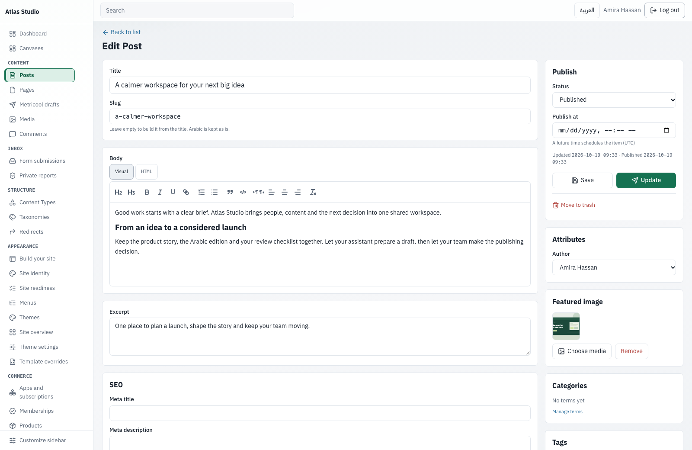
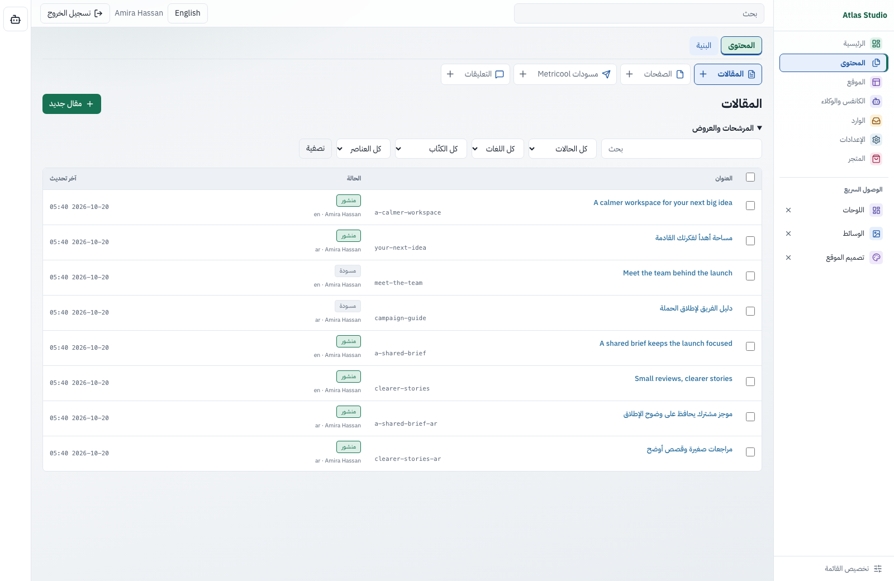
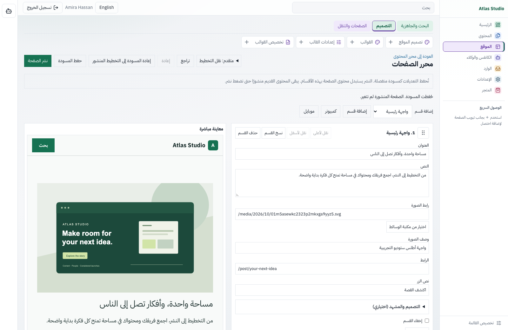
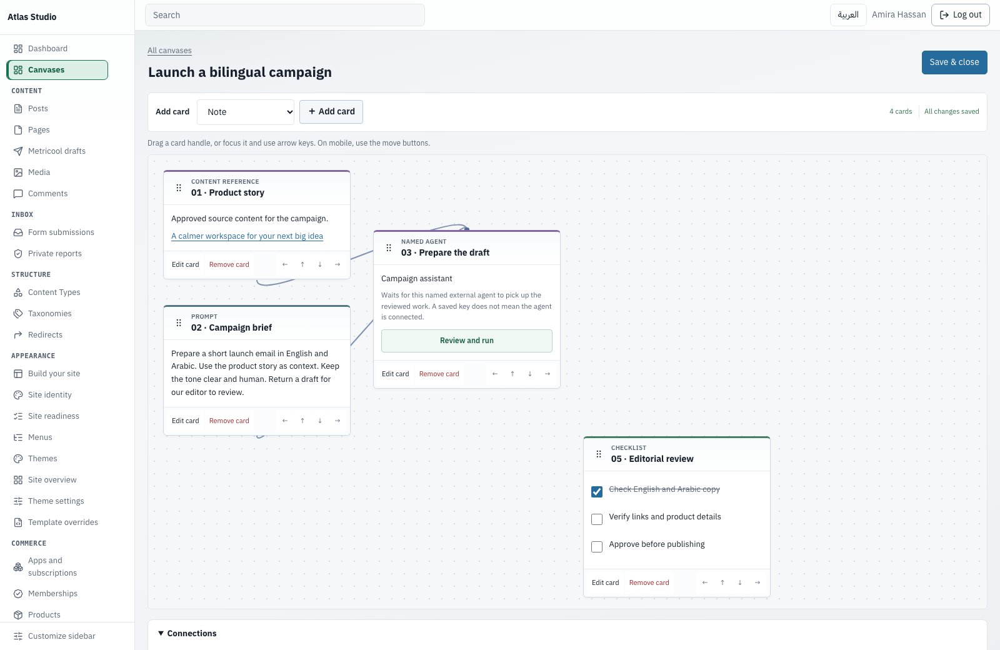
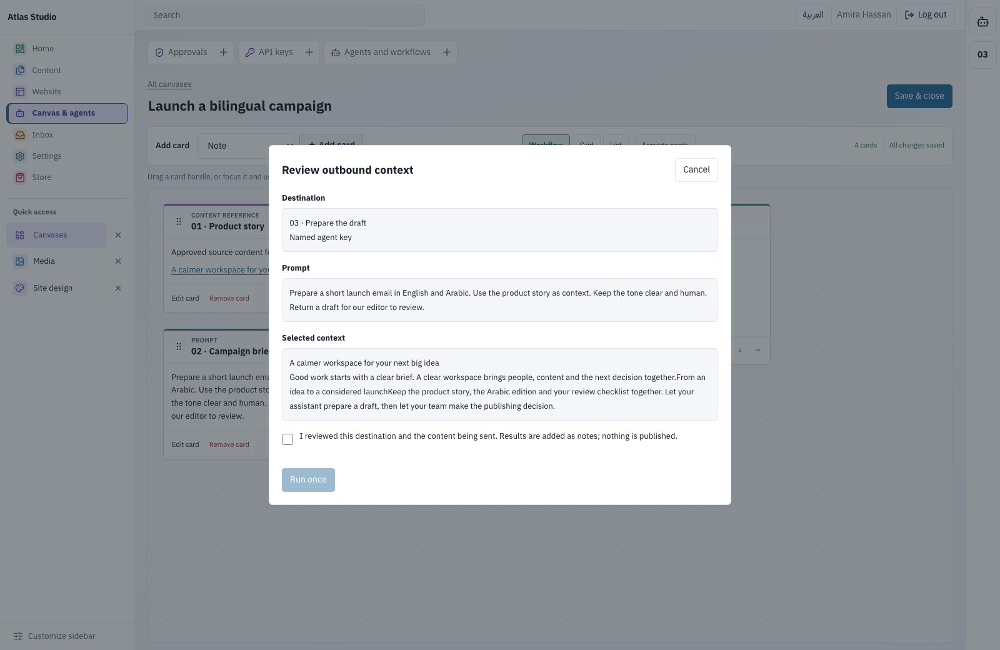
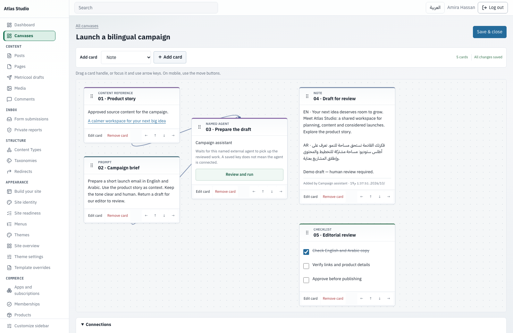

# GoRun

**A self-hosted CMS for your team and AI agents.**

[العربية](README.ar.md) · [Documentation](docs/README.md) · [Releases](https://github.com/zadstack/gorun/releases) · [Use an assistant](#start-with-your-ai-assistant) · [Contribute](CONTRIBUTING.md)

## Run it now

For a local trial on **macOS or Linux**, copy and paste this whole block. No Go, Docker, database setup or administrator privileges required.

```sh
(
  set -eu
  installer="$(mktemp)"
  trap 'rm -f "$installer"' EXIT
  curl -fsSL https://raw.githubusercontent.com/zadstack/gorun/main/install.sh -o "$installer"
  sh "$installer"
) &&
export PATH="$HOME/.local/bin:$PATH" &&
gorun start --data "$HOME/.local/share/gorun/site"
```

The installer detects Intel or ARM, downloads the latest release, verifies its SHA-256 checksum, and installs GoRun for your user. The block configures this terminal automatically, and the installer adds the default executable directory to your shell startup file for future terminals. No manual PATH setup. Your browser opens, SQLite and the default theme are prepared, and your first `admin` password appears **once** in the terminal. Save it. On first sign-in, choose your own password, email, site name and language. Restarting preserves your site and accounts.

The quick start requires **GoRun 0.4.0 or newer**. The installer refuses older releases without changing an existing installation.

The executable lives at `~/.local/bin/gorun`; your local site lives at `~/.local/share/gorun/site`. Stop the server with **Ctrl+C**. Repeating the block uses the same site. LAN access is a public, read-only preview; administration stays on localhost. Use `--local-only` when starting manually to disable LAN access. [Local setup and recovery](docs/local-start.md).

For a domain with HTTPS and a persistent service, use the [guided Linux server setup](docs/SERVER-SETUP.md). It asks for your domain and installation directory, verifies DNS, and reports the final URL and data path after acceptance checks. It requires Linux root access, Python 3 and Docker Compose; it uses verified public release downloads without a GHCR login. For an existing proxy or Coolify deployment, follow the [Docker / Coolify guide](deploy/coolify.md). The local preview is intended for development.

## Start with your AI assistant

On your computer or a server, copy this into an assistant with terminal access to the target machine:

```text
Set up GoRun from https://github.com/zadstack/gorun.
Read the official README and assistant setup guide first.
Ask whether this is a local trial or a public server deployment.
Check the operating system, architecture, and any existing site before changing anything.
Preserve existing data, users, themes, settings, and credentials.
For a local trial, use the official release installer with checksum verification.
For a server, ask for the domain and installation directory; verify DNS points to it.
Follow the supported production setup, with HTTPS, persistent data, and automatic restart.
Do not replace an existing site or proxy configuration without explicit approval.
Verify the public page and admin sign-in page at the final URL before reporting success.
Keep generated passwords, setup tokens, and keys out of chat, screenshots, and shared logs.
Let me complete first-login setup securely in the browser.
Report the final URL, installation and data paths, and stop/restart/update instructions.
If you lack terminal access or a prerequisite, explain exactly what is needed.
```

The instructions are tool-neutral. A chat-only assistant can explain the steps but cannot install software on your computer. [Assistant setup guide](docs/AI-ASSISTED-SETUP.md).

## Cloudflare Edge — in development

GoRun Edge is being developed as a separate Workers-based edition. The current milestone provides site-scoped manager permission contracts. The Worker runtime, storage/admin integration and a tested deployment template remain on the [Edge roadmap](https://github.com/zadstack/gorun/issues/46). A Deploy to Cloudflare button will be added after the template passes a real deployment test.

[](https://github.com/zadstack/gorun/actions/workflows/ci.yml) [](LICENSE)



## Why GoRun?

- **Your content and infrastructure.** A Go executable and SQLite, hosted by you. No Node.js or PHP at runtime.
- **Arabic and English from the start.** A bilingual dashboard with native RTL support and responsive site themes.
- **A complete editorial workflow.** Structured content, drafts, reviews, scheduled publishing, revision history and explicit staff permissions.
- **Agents with boundaries.** MCP tools, scoped agent keys, human approvals for sensitive changes and an audit trail. Separate REST keys serve other integrations.

## Measured, with context

In a controlled minimal article test at **50 requests/s**, median run p95 latency was **2.66 ms for GoRun**, **16.85 ms for WordPress + MariaDB**, and **0.66 ms for Astro static + Nginx**. Sampled peak working set was **114.54 MiB**, **203.78 MiB**, and **4.09 MiB**, respectively.

Three repetitions on one disposable host; two logical server CPUs and a 2 GiB budget per deployment; 100 identical synthetic articles; no TLS, CDN or full-page cache. Astro is a static-delivery reference, not a full CMS. **Edge is not yet runnable and has no measured result.** These numbers describe this workload, not general product superiority. [Full results, limitations, raw evidence and reproducible notebook](docs/BENCHMARKS.md).

## Write, review and publish

Manage posts, pages, custom content types, fields, media and navigation in one place. Give editors, authors and contributors the permissions they need, and review changes before publishing.



[Editorial workflow](docs/README.md) · [WordPress migration](docs/MIGRATION.md)

## Build a site you can make your own

Start with a bundled theme, create pages with section-based layouts, and preview before publishing. Child themes and filesystem templates let developers customize the result. Activating a theme does not create starter pages; use the site builder for starter content.



[Site builder](docs/SITE_BUILDER.md) · [Theme development](docs/THEME-DEVELOPMENT.md) · [Theme reference](docs/THEMES.md)

## Work with agents, keep the decisions

Connect an MCP client with an **AI agent** key. Its scopes are bounded by its owner's permissions; publishing, deleting and changing sensitive settings require human approval by default. REST integration keys are separate from agent keys.

Canvases bring selected content, instructions and agent results into one workspace. Results become private notes for review and do not publish content automatically. Configure your provider or agent connection before running it.

### A campaign, from brief to review

**1. Choose the context.** Bring an approved product story and a bilingual campaign brief onto the canvas. Connect only those cards to your named assistant.



**2. Review before running.** Inspect the destination, instructions and selected context. Confirm explicitly before starting the work. The agent can use only the selected context and tools allowed by its permissions.



**3. Keep the publishing decision.** The returned draft appears as a separate private note with its source. Review it alongside your checklist; running a canvas does not publish the content.



Switch between **Workflow**, **Grid** and **List** views. Arrange cards using their rendered heights; each connection has its own side port and a routed path. View changes preserve the saved content and connections. [Grid view](assets/branding/screenshots/canvas-grid-en.png) · [List view](assets/branding/screenshots/canvas-list-en.png).

*Screenshots use a fictional business and synthetic content. The example assistant response is supplied by a test client through the real MCP workflow; it is not a model-quality benchmark. [Arabic view](assets/branding/screenshots/canvas-ar.png) · [Mobile view](assets/branding/screenshots/canvas-mobile.png).*

**Available now:** external agent execution or managed text generation with a linked model. A visual agent bundle that manages Skills and multiple MCP-server connections is planned; it is not a shipped runtime capability.

[MCP and permissions](docs/MCP.md) · [Canvases](docs/CANVASES.md) · [REST API](docs/API.md)

## Operate with confidence

Schedule daily or weekly local backups, track verified success and storage, and inspect failure alerts. Preview a disposable, read-only restore on localhost before restoring into a new directory. `gorun doctor` diagnoses an existing site without migrating or repairing it.

[Backups and recovery](docs/BACKUPS.md) · [Local diagnostics](docs/local-start.md#diagnose-a-local-site)

## Find your next step

| I want to… | Start here |
| --- | --- |
| Install or deploy GoRun | [Installation](docs/GORUN-INSTALLATION.md) · [Production](docs/PRODUCTION.md) |
| Create or customize a theme | [Theme tutorial](docs/THEME-DEVELOPMENT.md) |
| Build an integration | [Plugin tutorial](docs/PLUGIN-DEVELOPMENT.md) · [REST](docs/API.md) · [MCP](docs/MCP.md) |
| Build on the Go core | [Architecture](docs/ARCHITECTURE.md) |
| Operate an existing site | [Backups](docs/BACKUPS.md) · [Upgrades](docs/UPGRADE.md) · [Troubleshooting](docs/TROUBLESHOOTING.md) |
| Explore everything | [Documentation index](docs/README.md) |

## Project status

GoRun is under active development. The current release is [0.4.0](https://github.com/zadstack/gorun/releases/tag/v0.4.0); the main branch may contain features awaiting release.

Run one server process per SQLite data directory. Canvases are private to their owner with explicit agent access. Full-site generation from a single prompt and an automatic core updater are not available. Backups restore into a new directory; switching live traffic remains an operator action. Provider-backed generation and payments require valid credentials and deployment-specific checks.

Screenshots show an isolated local installation with fictional demonstration content. They do not show customer data or a connected provider.

## Contribute

Bug reports, documentation improvements and contributions are welcome. Read the [contribution guide](CONTRIBUTING.md) and [security policy](SECURITY.md). GoRun is released under [GNU AGPL v3](LICENSE); see [NOTICE](NOTICE) and the [changelog](CHANGELOG.md).
