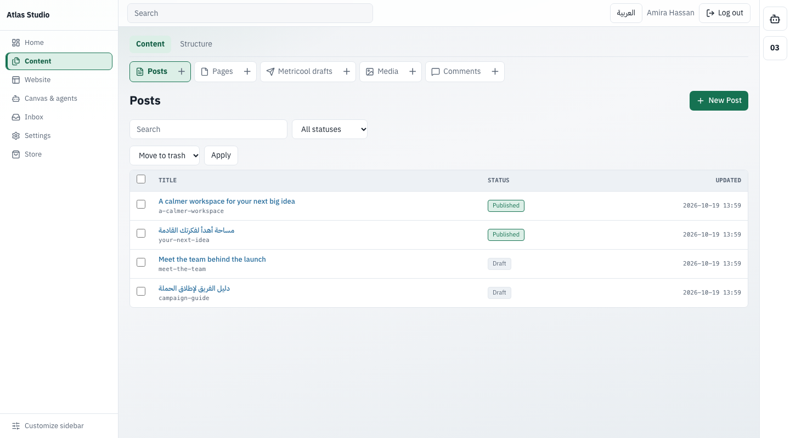
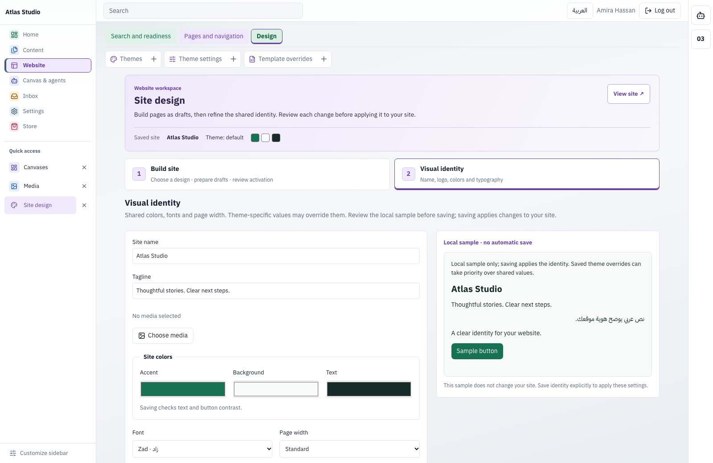
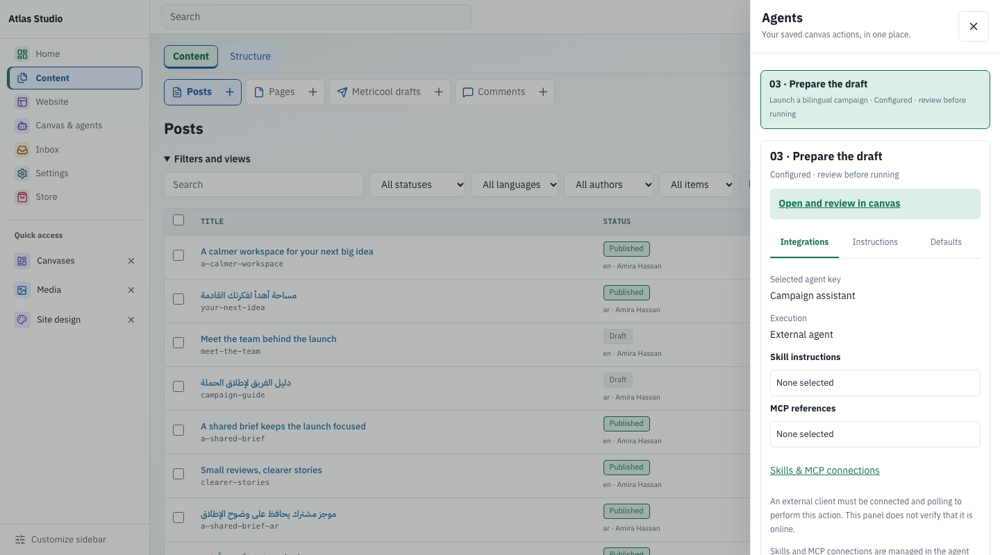
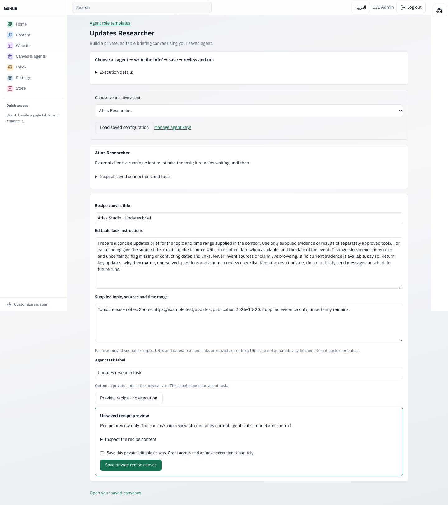
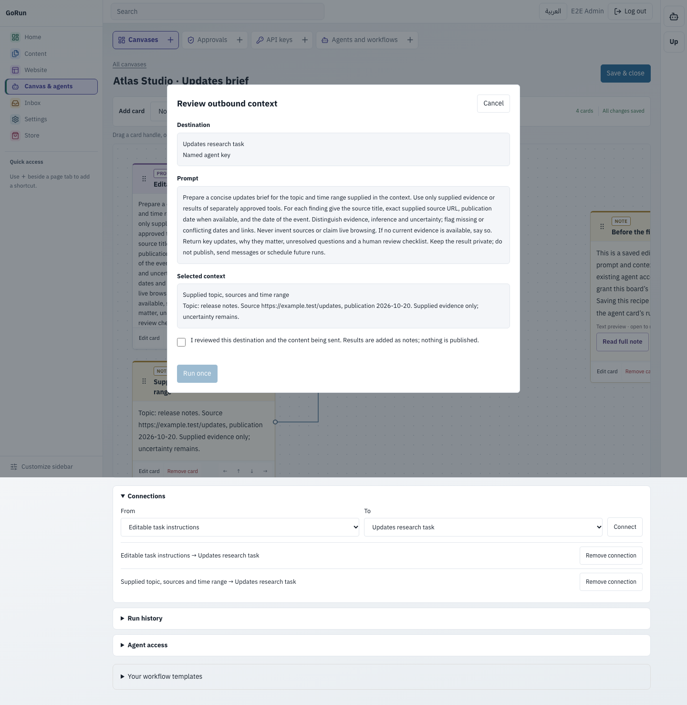
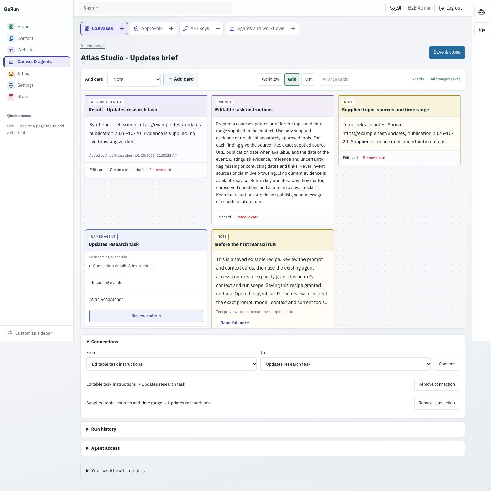
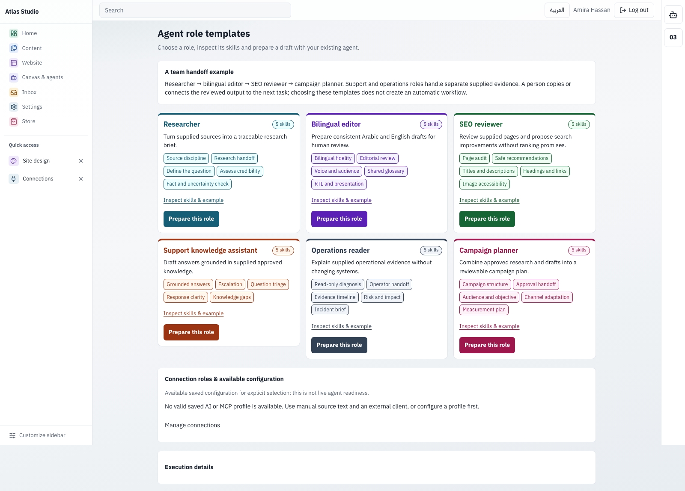

# GoRun

**A self-hosted CMS for your team and AI agents.**

[العربية](README.ar.md) · [Website guides](https://gorun.gocloud.run/gorun-guides) · [Documentation](docs/README.md) · [Releases](https://github.com/zadstack/gorun/releases) · [Use an assistant](#start-with-your-ai-assistant) · [Contribute](CONTRIBUTING.md)

## Run it now

For a local trial on **macOS or Linux**, copy and paste this whole block. No Go, Docker, database setup or administrator privileges required.

```sh
(
  set -eu
  installer="$(mktemp)"
  trap 'rm -f "$installer"' EXIT
  curl -fsSL https://raw.githubusercontent.com/zadstack/gorun/main/install.sh -o "$installer"
  sh "$installer"
) &&
export PATH="$HOME/.local/bin:$PATH" &&
gorun start --data "$HOME/.local/share/gorun/site"
```

The installer detects Intel or ARM, downloads the latest release, verifies its SHA-256 checksum, and installs GoRun for your user. The block configures this terminal automatically, and the installer adds the default executable directory to your shell startup file for future terminals. No manual PATH setup. Your browser opens, SQLite and the default theme are prepared, and your first `admin` password appears **once** in the terminal. Save it. On first sign-in, choose your own password, email, site name and language. Restarting preserves your site and accounts.

The quick start requires **GoRun 0.4.0 or newer**. The installer refuses older releases without changing an existing installation.

The executable lives at `~/.local/bin/gorun`; your local site lives at `~/.local/share/gorun/site`. Stop the server with **Ctrl+C**. Repeating the block uses the same site. LAN access is a public, read-only preview; administration stays on localhost. Use `--local-only` when starting manually to disable LAN access. [Local setup and recovery](docs/local-start.md).

For a domain with HTTPS and a persistent service, use the [guided Linux server setup](docs/SERVER-SETUP.md). It asks for your domain and installation directory, verifies DNS, and reports the final URL and data path after acceptance checks. It requires Linux root access, Python 3 and Docker Compose; it uses verified public release downloads without a GHCR login. For an existing proxy or Coolify deployment, follow the [Docker / Coolify guide](deploy/coolify.md). The local preview is intended for development.

## Start with your AI assistant

On your computer or a server, copy this into an assistant with terminal access to the target machine:

```text
Set up GoRun from https://github.com/zadstack/gorun.
Read the official README and assistant setup guide first.
Ask whether this is a local trial or a public server deployment.
Check the operating system, architecture, and any existing site before changing anything.
Preserve existing data, users, themes, settings, and credentials.
For a local trial, use the official release installer with checksum verification.
For a server, ask for the domain and installation directory; verify DNS points to it.
Follow the supported production setup, with HTTPS, persistent data, and automatic restart.
Do not replace an existing site or proxy configuration without explicit approval.
Verify the public page and admin sign-in page at the final URL before reporting success.
Keep generated passwords, setup tokens, and keys out of chat, screenshots, and shared logs.
Let me complete first-login setup securely in the browser.
Report the final URL, installation and data paths, and stop/restart/update instructions.
If you lack terminal access or a prerequisite, explain exactly what is needed.
```

The instructions are tool-neutral. A chat-only assistant can explain the steps but cannot install software on your computer. [Assistant setup guide](docs/AI-ASSISTED-SETUP.md).

## Cloudflare Edge — in development

GoRun Edge is a separate, experimental Workers-based edition with its own D1/R2 storage. Both [public reading](docs/EDGE.md) and optional [owner administration](docs/EDGE-ADMIN.md)—private drafts, review/publication, revisions and offline recovery—have passed actual Cloudflare HTTPS acceptance with isolated synthetic data. Administration stays disabled by default; temporary test access was revoked. [Validation record](docs/validation/edge-cloudflare-2026-10-19.json). Manager pairing and a supported deployment template remain on the [roadmap](https://github.com/zadstack/gorun/issues/46); no Deploy button is available. Edge is separate from the Full release binary and has no measured benchmark result.

[](https://github.com/zadstack/gorun/actions/workflows/ci.yml) [](LICENSE)


## Why GoRun?

- **Your content and infrastructure.** A Go executable and SQLite, hosted by you. No Node.js or PHP at runtime.
- **Arabic and English from the start.** A bilingual dashboard with native RTL support and responsive site themes.
- **A complete editorial workflow.** Structured content, drafts, reviews, scheduled publishing, revision history and explicit staff permissions.
- **Agents with boundaries.** MCP tools, scoped agent keys, human approvals for sensitive changes and an audit trail. Separate REST keys serve other integrations.

## A workspace that stays organized

Up to six primary sections keep related tools together, with contextual page tabs above the screen you are using. You see the tools your permissions allow; Store adds an optional seventh section when permitted commerce tools are available. Colored categories keep their text labels and selected borders. Personal visibility, navigation order and dashboard pins stay yours; pinned tools remain within reach under **Quick access** in the main sidebar.



The screenshots use an isolated demo site with fictional content. The layout mirrors for Arabic and stays usable on mobile. [Arabic mobile menu](assets/branding/screenshots/admin-navigation-ar-mobile.png) · [Workspace guide](docs/ADMIN_WORKSPACE.md).

## Measured, with context

In a controlled minimal article test at **50 requests/s**, median run p95 latency was **2.66 ms for GoRun**, **16.85 ms for WordPress + MariaDB**, and **0.66 ms for Astro static + Nginx**. Sampled peak working set was **114.54 MiB**, **203.78 MiB**, and **4.09 MiB**, respectively.

Three repetitions on one disposable host; two logical server CPUs and a 2 GiB budget per deployment; 100 identical synthetic articles; no TLS, CDN or full-page cache. Astro is a static-delivery reference, not a full CMS. **The experimental Edge prototype has no measured result.** These numbers describe this workload, not general product superiority. [Full results, limitations, raw evidence and reproducible notebook](docs/BENCHMARKS.md).

## Write, review and publish

Manage posts, pages, custom content types, fields, media and navigation in one place. Give editors, authors and contributors the permissions they need, and review changes before publishing.


[Editorial workflow](docs/README.md) · [WordPress migration](docs/MIGRATION.md)

## Build a site you can make your own

Start with a bundled theme, create pages with section-based layouts, and preview before publishing. Child themes and filesystem templates let developers customize the result. Activating a theme does not create starter pages; use the site builder for starter content. The default reading theme presents a featured article, recent posts and guide links drawn from actual published content. [Default-theme demo](assets/branding/screenshots/theme-home-en.png) · [Arabic article on mobile](assets/branding/screenshots/theme-post-ar-mobile.png).

**Website → Design → Site design** brings **Build site** and **Visual identity** into one workspace. Prepare pages as drafts, review activation separately, and preview colors and typography locally before explicitly saving identity. Existing site content and theme settings remain yours. [Site design guide](docs/SITE-DESIGN-WORKSPACE.md).



[Build-site step](assets/branding/screenshots/site-design-build-en.png) · [Arabic mobile identity](assets/branding/screenshots/site-design-identity-ar-mobile.png).


[Site builder](docs/SITE_BUILDER.md) · [Theme development](docs/THEME-DEVELOPMENT.md) · [Theme reference](docs/THEMES.md)

## Work with agents, keep the decisions

Connect an MCP client with an **AI agent** key. Its scopes are bounded by its owner's permissions; publishing, deleting and changing sensitive settings require human approval by default. REST integration keys are separate from agent keys.

Canvases bring selected content, instructions and agent results into one workspace. Results become private notes for review and do not publish content automatically. Configure your provider or agent connection before running it.

With a configured AI provider, review the exact destination and site context before separately confirming a request for canvas suggestions. Suggestions create an unbound starting point; choose its executor and permissions yourself. [AI suggestion workflow](docs/CANVAS-AI-SUGGESTIONS.md).


[Arabic suggestions on mobile](assets/branding/screenshots/canvas-ai-suggestions-ar-mobile.png). These documentation examples come from a scripted local HTTP provider, not a live model or evidence of provider availability.

Each agent or provider card shows its own ID and selected agent/provider identity, with a signed webhook matched to a saved command and reviewed instructions. Incoming-event rules start disabled and require explicit review and enablement; external agents still need their MCP client running. [Configure canvas events](docs/CANVASES.md#incoming-events-on-agent-and-provider-cards).

### Your saved actions, within reach

The opposite-side agents rail opens your own canvas cards. Inspect **Integrations**, **Instructions** and **Defaults**, then open the original card to configure or review it. The drawer reads saved configuration; opening it does not run an agent. **Configured** does not mean online, and an external agent still needs its connected client.



[Arabic mobile drawer](assets/branding/screenshots/agents-drawer-ar-mobile.png). Skills and multiple MCP-server resources are not assembled or verified by this drawer.

### An updates brief, from setup to review

**1. Make the recipe yours.** Open **Agent role templates → Build an Updates Researcher recipe**. Choose your saved agent, edit the instructions and supply the topic, source excerpts and dates. Inspect its existing model and MCP tool configuration; previewing or saving creates no execution or access grants. [Recipe setup](docs/AGENT-RECIPES.md).



**2. Review the actual request.** Save the private canvas, grant the agent the context it needs, then inspect the exact instructions and context in the run review. Confirm the run separately. Managed MCP tool calls retain their individual approvals; an external agent needs its running client.



**3. Read the private result.** The returned brief becomes an attributed note alongside the original instructions and sources. Compact card types, separate connection points and a full-note reader make the work easier to inspect. Publishing remains a separate decision.



Switch between **Workflow**, **Grid** and **List** views without changing the saved content or connections. [Arabic mobile story: setup](assets/branding/screenshots/researcher-setup-ar-mobile.png) · [Review](assets/branding/screenshots/researcher-review-ar-mobile.png) · [Result](assets/branding/screenshots/researcher-result-ar-mobile.png).

*These screenshots show the current source build with fictional Atlas Studio data; the recipe and updated cards are not included in the v0.10.0 download. A test client sends the reviewed request to a scripted local HTTP provider, then returns its response through the real MCP workflow. This demonstrates setup, consent and private delivery; it does not demonstrate live news retrieval or model quality. This recipe is manually run, with no daily polling.*

**Agent bundles:** add bounded inline skill instructions and reference text to reviewed external-agent or managed-text requests, and attach version-pinned MCP connection profiles with saved discovery status. [Manage skills and MCP references](docs/AGENT-BUNDLES.md). External clients configure their own endpoints, credentials and tools. Named OpenAI-compatible managed text agents can use [explicitly selected MCP tools](docs/MANAGED-MCP-TOOLS.md), with owner review of every exact call and a private final note. This mode starts disabled and supports manual runs only.

**Start from an inspectable role.** Six compact bilingual examples combine five inline skills each. Inspect the instructions, then prepare an unsaved bundle for an owned agent. A role grants no permissions, chooses no provider and makes no tool call. [Role templates](docs/AGENT-ROLE-TEMPLATES.md).



[Arabic mobile roles](assets/branding/screenshots/agent-roles-ar-mobile.png). The catalog shows example instructions; it is not a team of running agents.

[MCP and permissions](docs/MCP.md) · [Canvases](docs/CANVASES.md) · [REST API](docs/API.md)

## Operate with confidence

Schedule daily or weekly local backups, track verified success and storage, and inspect failure alerts. Preview a disposable, read-only restore on localhost before restoring into a new directory. `gorun doctor` diagnoses an existing site without migrating or repairing it.

Extension screens distinguish **Server directory**, **Uploaded ZIP** and **Legacy: method not recorded**. An installation method does not establish a package's origin or safety. [Installation-method guide](docs/EXTENSION-INSTALLATION-METHODS.md).


[Arabic extension methods on mobile](assets/branding/screenshots/extensions-methods-ar-mobile.png).

[Backups and recovery](docs/BACKUPS.md) · [Local diagnostics](docs/local-start.md#diagnose-a-local-site)

## Find your next step

| I want to… | Start here |
| --- | --- |
| Install or deploy GoRun | [Installation](docs/GORUN-INSTALLATION.md) · [Production](docs/PRODUCTION.md) |
| Create or customize a theme | [Theme tutorial](docs/THEME-DEVELOPMENT.md) |
| Build an integration | [Plugin tutorial](docs/PLUGIN-DEVELOPMENT.md) · [REST](docs/API.md) · [MCP](docs/MCP.md) |
| Build on the Go core | [Architecture](docs/ARCHITECTURE.md) |
| Operate an existing site | [Backups](docs/BACKUPS.md) · [Upgrades](docs/UPGRADE.md) · [Troubleshooting](docs/TROUBLESHOOTING.md) |
| Explore everything | [Documentation index](docs/README.md) |

## Project status

GoRun is under active development. Use the [latest stable release](https://github.com/zadstack/gorun/releases/latest); the main branch may contain features awaiting release.

Run one server process per SQLite data directory. Canvases are private to their owner with explicit agent access. Full-site generation from a single prompt and an automatic core updater are not available. Backups restore into a new directory; switching live traffic remains an operator action. Provider-backed generation and payments require valid credentials and deployment-specific checks.

Screenshots show an isolated local installation with fictional demonstration content. They do not show customer data or a connected provider.

## Contribute

Bug reports, documentation improvements and contributions are welcome. Read the [contribution guide](CONTRIBUTING.md) and [security policy](SECURITY.md). GoRun is released under [GNU AGPL v3](LICENSE); see [NOTICE](NOTICE) and the [changelog](CHANGELOG.md).
